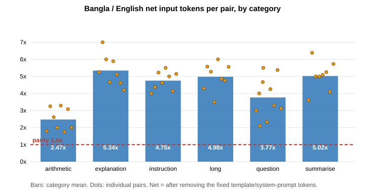

# Assignment 2 report - English vs Bangla token cost

**Model:** `qwen2.5:7b` (Ollama). **Settings, identical for both languages:** temperature 0, seed 42,
max tokens (`num_predict`) 200, `num_ctx` 4096, top_p 0.9, top_k 20, system prompt
"You are a helpful assistant. Answer briefly." The prompt gives no instruction about the answer language.
Prices are notional: $0.15 per million input tokens and $0.60 per million output tokens.

**Dataset** (`dataset.tsv`): 50 aligned pairs in 6 categories (question 10, instruction 8, explanation 8,
arithmetic 8, summarise 8, long 8), from 4 to 56 English words. Bangla numbers use Bangla digits (১৫, ২৭), as
normal Bangla text does. *The Bangla was drafted with an AI assistant and must be checked pair by pair by the student
(see `AI_ASSISTANT_LOG.md`).*

**Counting.** Tokens are Ollama's own `prompt_eval_count` (input) and `eval_count` (output), read in `counter.py`.
- *Template overhead:* a 1-token prompt (`"a"`) costs 23 input tokens, so the chat template plus the system prompt
  adds **22 tokens** to every call. I report raw input tokens and **net** input tokens (raw − 22). Net shows the
  language effect itself.
- *Prompt cache:* each check prompt was sent twice. The counts were 29→29 (English) and 43→43 (Bangla), so this
  Ollama version does not shrink `prompt_eval_count` on a repeat. Every prompt was still sent exactly once, with
  English and Bangla interleaved pair by pair.

## Results (100 calls, `results/summary.json`)

| Measure | English | Bangla | Bangla ÷ English |
|---|---|---|---|
| Input tokens, total (= **input cost ratio**) | 2,073 | 5,543 | **2.67** |
| Net input tokens, total | 973 | 4,443 | **4.57** |
| Output tokens, total | 1,782 | 5,468 | 3.07 |
| Total cost (USD) | 0.001380 | 0.004112 | **2.98** |
| Latency, mean / median (s per call) | 6.81 / 4.08 | 21.96 / 21.90 | 3.2 / 5.4 |
| Answers cut at 200 tokens | 3 | 12 | — |

| Per-pair ratio (Bangla ÷ English) | mean | median | min | max | 95% bootstrap CI of mean |
|---|---|---|---|---|---|
| Input tokens | 2.39 | 2.15 | 1.20 | 4.47 | 2.16 – 2.63 |
| Net input tokens | 4.36 | 4.65 | 1.75 | 7.00 | 4.00 – 4.72 |
| Output tokens | 4.93 | 3.95 | 0.74 | 18.18 | 3.97 – 6.06 |
| Total cost | 3.78 | 3.44 | 1.00 | 11.57 | 3.22 – 4.40 |

| Category | Net input ratio (mean) | Raw input ratio | Total cost ratio |
|---|---|---|---|
| explanation | **5.34** | 2.20 | 4.11 |
| summarise | 5.02 | 3.07 | 4.06 |
| long | 4.98 | 3.84 | 2.58 |
| instruction | 4.75 | 2.06 | **5.11** |
| question | 3.77 | 1.72 | 4.49 |
| arithmetic | **2.47** | 1.61 | 2.13 |

**Largest gap:** explanation and summarise prompts, where content words such as মুদ্রাস্ফীতি, সালোকসংশ্লেষণ and
হৃদ্‌যন্ত্রের are split into many pieces. **Smallest gap:** arithmetic, where most of the prompt is short numbers and
symbols. The *raw* ratio is lowest for short prompts because the fixed 22-token overhead dilutes it. For long
prompts raw and net are close (3.84 vs 4.98).

**Surprising case - pair 20.** "Briefly explain what inflation means." is 7 net tokens. "মুদ্রাস্ফীতি মানে কী,
সংক্ষেপে ব্যাখ্যা করো।" is 49 net tokens (**7.0×**, the highest pair). The sentence is short, but each rare compound
word is broken into many byte-level pieces (Bangla uses 3 bytes per character in UTF-8). A short Bangla prompt is not
a cheap prompt. A second surprise was on the output side. Pair 5 ("largest ocean") got an 11-token correct English
answer, but the Bangla answer was a wrong, rambling 200-token text cut at the limit (ratio 18.2). Output cost
depends as much on answer *quality* in the language as on the tokenizer.

## Quality check (10 pairs, same 200-token limit)

| Pair | English answer | Bangla answer | Bangla as good? |
|---|---|---|---|
| 1 capital of Japan | Tokyo ✔ | "টাকোয়া" (wrong name) | **No** |
| 6 boiling point | 100 °C ✔ | garbled numbers (99.70448…) | **No** |
| 8 spider legs | 8 ✔ | 6 (wrong) | **No** |
| 14 "good morning" in French | Bonjour ✔ | bonjour ✔, longer | Yes |
| 22 weather vs climate | clear ✔ | confused definition, cut at 200 | **No** |
| 27 15 + 27 | 42 ✔ | 15 + 27 = 42 ✔ | Yes |
| 30 25% of 200 | 50 ✔ | 50 ✔ | Yes |
| 33 Rahim's money | 32 ✔ | ৩২ ✔ | Yes |
| 36 summarise exercise | good ✔ | good, one odd phrase | Yes (slightly worse) |
| 46 tea-shop profit | correct method, cut at 200 | correct method, cut at 200 | Equal (both incomplete) |

6 of 10 are as good; 4 of 10 are clearly worse in Bangla, all factual or explanation prompts. Arithmetic held up.
48 of 50 Bangla prompts were answered in Bangla. The other two were pure equations ("15 + 27 = 42").

## Conclusions
1. With the same meaning, Bangla input costs about **2.7× the tokens overall** on qwen2.5:7b, or **4.4–4.6×
   after removing the fixed template overhead** (per-pair mean 4.36, 95% CI 4.00–4.72). The spread is wide (1.75–7.0).
2. Total notional cost is **~3×** (overall 2.98; per-pair mean 3.78, CI 3.22–4.40), because Bangla answers were also
   longer. 12 Bangla answers vs 3 English ones hit the 200-token cap, so Bangla output (and its cost) is *understated*.
3. Latency follows token count: Bangla calls took 3.2× longer on average.
4. Quality was lower in Bangla for factual questions on this 7B model. Cheaper is not the only gap.

## Bonus - second model: `qwen2.5:3b`
I ran the same 100 prompts with identical settings: `python -m token_cost.runner --model qwen2.5:3b --out results_3b`,
then `python -m token_cost.compare_models` (→ `model_comparison.json`).

| Measure | qwen2.5:7b | qwen2.5:3b |
|---|---|---|
| Template overhead | 22 | 22 |
| Prompts with **identical** input count | — | **100 / 100** |
| Bangla ÷ English input tokens (total) | 2.67 | 2.67 |
| Bangla ÷ English total cost | 2.98 | 2.88 |
| Output tokens EN / BN | 1,782 / 5,468 | 2,116 / 6,189 |
| Mean latency EN / BN (s) | 6.81 / 21.96 | 4.66 / 14.25 |
| Answers cut at 200 tokens EN / BN | 3 / 12 | 3 / 18 |

**Tokenizer comparison:** both models use the same Qwen2.5 tokenizer, so every prompt has exactly the same input
count. The Bangla input penalty is a property of the tokenizer, not of model size. The models differ only on the
output side:
- 3b is about 1.5× faster per call.
- 3b writes longer answers, with more of them cut at the cap.
- 3b is weaker in Bangla. For example, it gave "দোকান" (shop) as the capital of Japan and talked about fish in the
  spider question.

One surprise: 3b answered the English "What is 15 plus 27?" with "32", which is wrong, but the Bangla version
correctly (১৫ + ২৭ = ৪২). A model from another family with a different tokenizer (for example `gemma2:2b`) would
be the next step to see a *different* input ratio.

**Limits.** One run per prompt and model (temperature 0), 50 pairs, one translator (AI-drafted, to be reviewed).
Bangla digits were used on purpose. Prompts with Latin digits would probably narrow the arithmetic gap.
